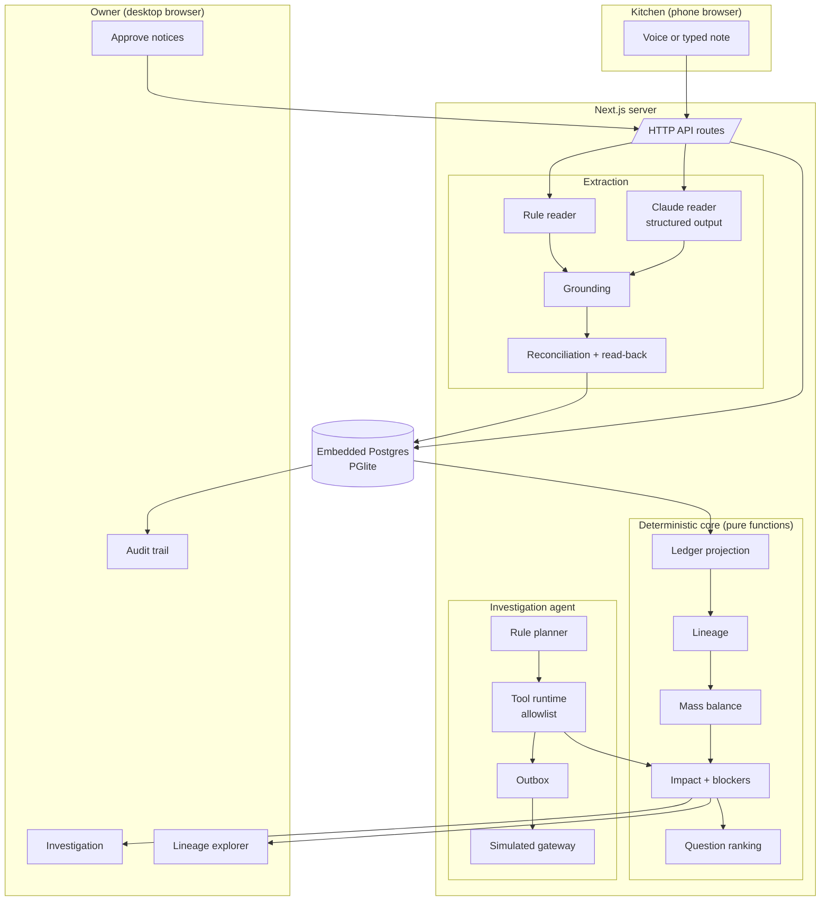
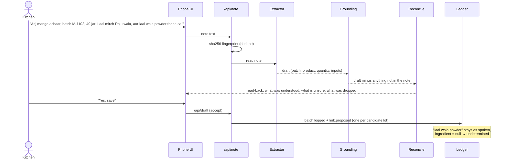
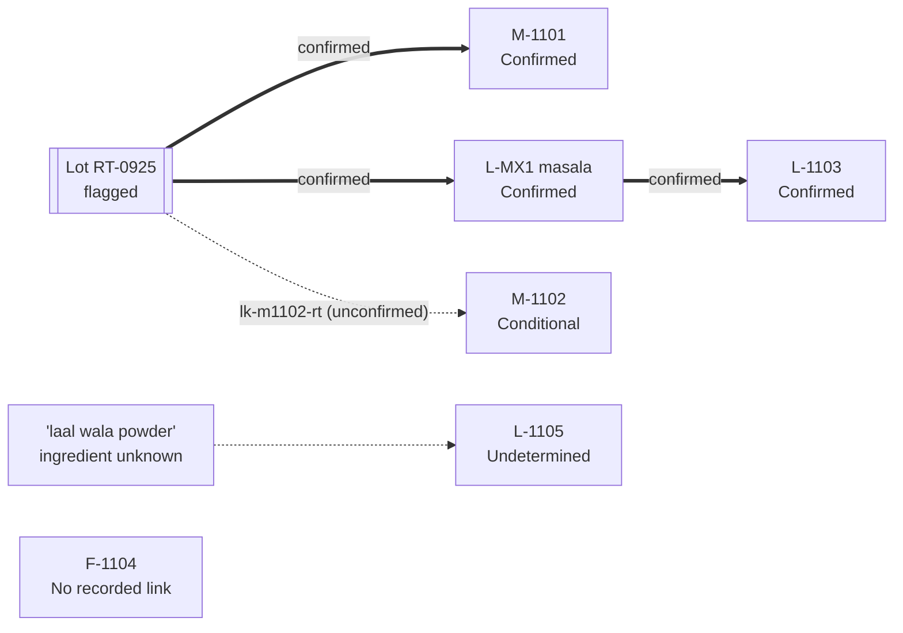
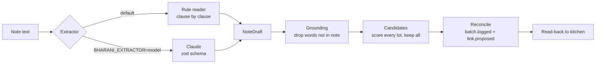
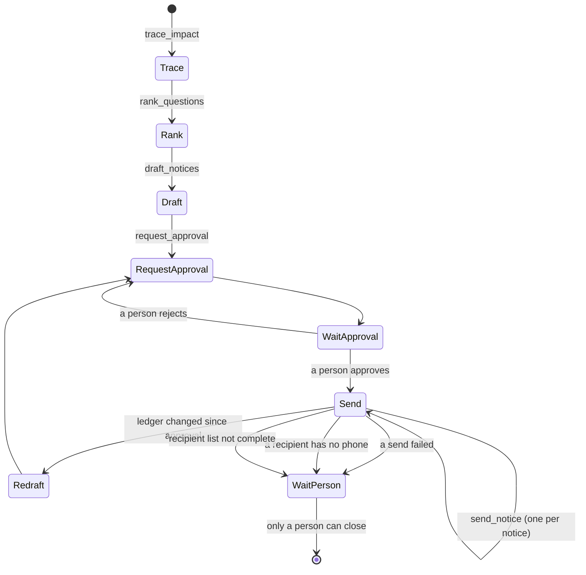

# Bharani

**Recall traceability for small food makers: what the records show, what they cannot show, and who to ask next.**

When a supplier flags an ingredient lot (say, a sack of chilli powder), a small food business has to answer three questions fast:

1. Which of our batches might contain it?
2. Who did we sell those jars to?
3. Is that list complete, and if not, why not?

Most tools answer the first two from whatever links someone typed in, and silently treat everything else as fine. Bharani never does that. Each batch, recipient and jar is placed in one of **four honest classes**. The system says out loud what is missing, and it ranks the questions that would close the gaps fastest.

> Built for Tech4Bharat 2026. Every business, person and lot in the demo is fictional. Bharani is a record and decision-support tool. It is **not** a certified regulatory compliance system, it never declares food safe, and it never contacts a regulator.

| | |
|---|---|
| Blueprint (Parts A–K) | https://drive.google.com/file/d/1A9J2MOWRAS5wANWxRHOu_4jxwS6QGpKQ/view?usp=sharing |
| Figma design | https://www.figma.com/design/uZmx4WTZ8ksjuw04Wlhrh3 |
| Measured results | [`eval/results/`](eval/results) |

---

## Contents

- [The four classes](#the-four-classes)
- [Quick start](#quick-start)
- [Architecture](#architecture)
- [The ledger](#the-ledger)
- [The lineage engine](#the-lineage-engine)
- [Mass balance and blockers](#mass-balance-and-blockers)
- [Question ranking](#question-ranking)
- [Reading kitchen notes](#reading-kitchen-notes)
- [The investigation agent](#the-investigation-agent)
- [Storage](#storage)
- [HTTP API](#http-api)
- [The demo scenario](#the-demo-scenario)
- [Testing](#testing)
- [Evaluation](#evaluation)
- [Project structure](#project-structure)
- [Design system](#design-system)
- [Known limits](#known-limits)

---

## The four classes

| Class | Meaning | What the screen shows |
|---|---|---|
| **Confirmed** | A chain of confirmed links reaches the flagged lot | The chain, and the evidence behind each link |
| **Conditional** | The batch reaches the lot only if certain unconfirmed links are true | The exact links it depends on, and the question that would settle each |
| **Undetermined** | The records cannot rule the lot in or out (e.g. "laal wala powder", source unknown) | The gap, and who can fill it |
| **No recorded link** | The records show no path to the lot | The words "no recorded link", never "safe" |

The recipient list is called **complete** only when nothing blocks that claim. Even then it means complete against the records held.

---

## Quick start

Requires **Node 22+**.

```bash
npm install
npm test                      # 47 tests, ~5 s
npm run typecheck
npm run build && npm start    # http://localhost:3100
```

The app seeds the demo scenario on first start. Data lives in embedded Postgres under `.data/` (git-ignored). The **Reset** button in the app restores the scenario.

| Script | What it does |
|---|---|
| `npm run dev` | Dev server on port 3100 |
| `npm test` | Run all tests once |
| `npm run eval` | Traceability benchmark → `eval/results/traceability.json` |
| `npm run eval:extraction` | Note-reading benchmark → `eval/results/extraction-rules*.json` |
| `npm run live-check` | One live call to the Claude API to check your key |

### Optional: model-based note reading

By default, notes are read by a deterministic rule reader. To use Claude instead:

```bash
export ANTHROPIC_API_KEY=...          # never commit this
BHARANI_EXTRACTOR=model npm start
# BHARANI_MODEL overrides the model (default: claude-opus-5-5)
```

Either reader produces the same draft shape and goes through the same grounding and reconciliation. A model can never create a confirmed link.

---

## Architecture



**One rule holds the design together.** The AI reads notes. A deterministic engine decides lineage. A person approves anything that leaves the building.

| Layer | Responsibility | May it change facts? |
|---|---|---|
| Capture | Turn speech or typing into note text; fingerprint it | No |
| Extraction | Turn note text into a draft batch | No. It only *proposes* |
| Reconciliation | Turn an accepted draft into events and proposed links | Writes events only after a person accepts the draft |
| Core engine | Compute lineage, classes, balance, blockers, questions | No. It is a pure read of the ledger |
| Agent | Run the investigation procedure | Only through allowlisted tools; cannot approve, confirm or close |
| People | Confirm links, accept drafts, approve notices, close investigations | Yes |

### A kitchen note, end to end



---

## The ledger

Everything is an **append-only event**. Current state is a pure function of the event log (`project(events)`), so:

- **Corrections never erase history.** A `batch.corrected` adds a new event; the original stays.
- **Any past state can be rebuilt** with `asOf(rev)`. You can show what was known when a decision was made.
- **Appends are idempotent.** Each event has an id, and inserts use `on conflict (id) do nothing`.

### Event types

| Area | Events |
|---|---|
| Reference data | `party.registered`, `party.updated`, `ingredient.defined`, `product.defined` (with aliases) |
| Ingredient lots | `lot.received`, `lot.issued`, `stock.counted`, `loss.recorded` |
| Batches | `batch.logged`, `batch.corrected`, `batch.voided`, `batch.accepted` |
| Links | `link.proposed`, `link.confirmed`, `link.rejected`, `link.reopened`, `input.source_unknown` |
| Dispatch | `dispatch.recorded`, `dispatch.corrected`, `dispatch.voided` |

A **link** connects one batch input to a source. The source is either an ingredient **lot** or an earlier **batch** (e.g. a masala mix made in another kitchen and used in pickles). Confirming one link rejects its sibling candidates for that input; reopening restores them.

---

## The lineage engine

`src/core/lineage.ts`

Each unconfirmed link is treated as a named boolean variable. For every batch, the engine computes the condition under which it contains the flagged lot, as a **monotone formula in disjunctive normal form (DNF)**:

- each clause is one path from the lot to the batch;
- each clause lists the unconfirmed links that path needs;
- `[]` (no clauses) means *false* and `[[]]` (one empty clause) means *confirmed*.

Absorption keeps formulas minimal: if one path needs `{a}` and another needs `{a, b}`, the second is dropped.



Here M-1102's condition is `[[lk-m1102-rt]]`. It contains the lot if and only if that one link is true.

### Soundness rules

These rules exist so the engine can never quietly rule a batch out:

| Rule | Why |
|---|---|
| Candidate lists are never truncated | Dropping the 5th candidate could drop the true source |
| An input with no confirmed ingredient and only lot links always gets an `input_unidentified` gap | A model's wrong ingredient guess must not make a batch look clear |
| A recipe ingredient the log never mentions raises `recipe_input_missing` | Silence is not evidence |
| A sub-batch with open gaps passes `subbatch_undetermined` downstream | Uncertainty flows through masala mixes |
| Cycles raise `lineage_cycle` and are not followed | Bad data must not hang or fake an answer |
| Unknown source of a *different* ingredient does not count | Avoids false alarms |

The **possible-worlds test** (`tests/worlds.test.ts`) checks the formulas against brute force. It generates random ledgers, enumerates every true/false assignment of the open links, and compares. Across 179,365 worlds covering 1,121 conditional batches, the engine and brute force always agreed.

---

## Mass balance and blockers

`src/core/balance.ts`, `src/core/impact.ts`

**Per lot:** received − confirmed use − conditional use − counted stock − recorded loss. While links are open this is a **range** (`unexplainedMin`..`unexplainedMax`). A lot is flagged when the range leaves a 2% tolerance or the lot is overdrawn. Uses recorded without a quantity are counted as open.

**Per batch:** jars made − jars dispatched = jars with no known destination.

**Contradictions** are reported, never resolved by picking a winner: `duplicate_batch_code`, `lot_overdrawn`, `dispatched_more_than_made`, `used_before_received`.

`traceImpact(ledger, flaggedLots)` returns batches, recipients, jars per class, unknown-buyer jars, unaccounted jars, and a list of **blockers**. `recipientListComplete` is true only when the blocker list is empty.

| Blocker code | Example message |
|---|---|
| `conditional_batches` | 1 batch depends on unconfirmed links |
| `undetermined_batches` | 1 batch has records that cannot rule this lot in or out |
| `lot_unexplained` | Between 0 kg and 1 kg of this lot is not explained by the records |
| `batch_unaccounted` | 10 jars have no recorded destination |
| `recipient_unknown` | 20 dispatched jars went to a buyer the records do not identify |
| `recipient_no_contact` | 1 recipient has no phone number on record |
| `contradiction` | Records disagree and need a person |

---

## Question ranking

`src/core/questions.ts`

For each open question (which source, where unaccounted stock went, who an unknown buyer is, a missing contact), the engine **replays every possible answer** through the full trace and measures how many jars would move out of the open classes. Questions are sorted by that number. This is deterministic, with no model involved.

Answers are recorded as ledger events like any other. A person may answer "cannot tell", and the question is not asked again.

---

## Reading kitchen notes

`src/extract/`



- **Rule reader** (`rules.ts`) splits the note into clauses and matches batch codes, products, quantities and ingredient words (Hindi, English, Hinglish). An unknown phrase keeps its **exact spoken words** with `ingredient: null`; it is never guessed.
- **Claude reader** (`claude.ts`) uses the Anthropic SDK with structured output against the same zod schema. It is unmeasured so far; see [Known limits](#known-limits).
- **Grounding** (`ground.ts`) removes any word, name or code the note did not contain.
- **Candidates** (`src/core/candidates.ts`) score every lot by exact printed code, trigram name similarity, date and quantity feasibility, whether it was issued to that kitchen, a supplier hint, and recency. Infeasible lots are excluded; nothing feasible is cut.
- **Reconciliation** (`reconcile.ts`) writes proposed links only. Model guesses are tagged `source: "model"` with a damped score. The read-back tells the kitchen what was unsure or dropped.

---

## The investigation agent

`src/agent/`

The agent is a **fixed procedure over typed tools**, not free-form model reasoning. Every step is journalled and visible in the audit trail.



### What the agent may and may not do

| Tier | Tools | Enforcement |
|---|---|---|
| **Agent may call** | `trace_impact`, `rank_questions`, `draft_notices`, `request_approval`, `send_notice` (approved only), `draft_schedule_i` | Allowlist in `runtime.ts` |
| **Human only** | `decide_approval`, `confirm_link`, `close_investigation` | No agent implementation exists; calls are refused with a `PolicyError` and audited |
| **Never** | `declare_safe`, `declare_recall_unnecessary`, `file_with_regulator`, `delete_records`, `edit_notice_after_approval` | No implementation anywhere |

### Delivery guarantees

| Failure | Handling |
|---|---|
| Crash mid-run | Steps are journalled by tool + args + ledger revision; re-running resumes without repeating work |
| Lost or repeated provider reply | Each send uses idempotency key `approvalId:noticeId`; never delivered twice |
| Hanging provider | Timeout, retry with backoff, then give up honestly and mark the notice failed |
| Records changed after approval | Approval is bound to a hash of the exact payload; the notice is redrafted at the current revision and needs fresh approval |
| Mixed-status notice | Each line uses the wording for its own class; a conditional jar is never listed under a confirmed statement |

Delivery goes through `SimulatedGateway`, which supports fault injection (`hangOnCalls`, `loseReplyOnCalls`, `failOnCalls`, `crashAfterDeliveries`). **No real SMS or WhatsApp is sent**, and the UI labels every send as simulated.

`draft_schedule_i` prepares the fields of the FSSAI Food Recall Regulations Schedule I with unknowns marked, for a person to review and file. Bharani does not file anything.

---

## Storage

`src/server/db.ts` uses PGlite (embedded Postgres) with a persistent directory, so there is no database server to install.

| Table | Holds |
|---|---|
| `events` | The append-only ledger |
| `evidence` | Note text and sha256 fingerprints, referenced by events |
| `drafts` | Read-backs awaiting a kitchen's acceptance |
| `investigations` | Open and closed recall checks |
| `agent_steps` | Step journal for crash-safe resumption |
| `notices` | Drafted notices per investigation |
| `approvals` | Approval requests, decisions and payload hashes |
| `outbox` | Per-notice send status (queued, sent, failed) |
| `receipts` | Gateway delivery receipts |
| `audit` | Every agent call, refusal and human decision |

---

## HTTP API

All routes are under `src/app/api/`.

| Method | Route | Purpose |
|---|---|---|
| `GET` | `/api/state` | Full UI snapshot: trace, questions, lineage, notices, audit |
| `POST` | `/api/note` | Submit a kitchen note; returns a draft and read-back |
| `POST` | `/api/draft` | Accept a draft; writes ledger events (idempotent) |
| `POST` | `/api/answer` | Answer a ranked question |
| `POST` | `/api/agent` | Run the investigation agent until it must wait |
| `POST` | `/api/approval` | A person approves or rejects notices |
| `POST` | `/api/reset` | Restore the demo scenario |

---

## The demo scenario

`src/demo/scenario.ts` describes a fictional collective, **Sakhi Pickles**, with three kitchens (Meena, Farzana and Lakshmi). Supplier Raju Traders reports that chilli powder lot **RT-0925** is under investigation.

| Batch | Class | Why |
|---|---|---|
| M-1101 | Confirmed | Kitchen note names the printed code "RT-0925" |
| L-MX1 (masala mix) | Confirmed | Made from RT-0925 |
| L-1103 | Confirmed | Uses L-MX1 |
| M-1102 | Conditional | Depends on one unconfirmed link to RT-0925 |
| L-1105 | Undetermined | "laal wala powder", source unknown |
| F-1104 | No recorded link | No path in the records |

**Totals:** 100 confirmed jars, 40 conditional, 30 undetermined, 50 with no recorded link. Another 20 dispatched jars went to an unidentified buyer, 10 jars have no recorded destination, and the Thursday haat stall has no phone number. So Bharani **refuses** to call the recipient list complete, and says exactly why.

---

## Testing

```bash
npm test
```

**47 tests in 5 files**, all passing:

| File | Covers |
|---|---|
| `tests/engine.test.ts` | Lineage, masala carry-through, recipients, mass balance, undetermined inputs, missing recipe inputs, contradictions, corrections and `asOf`, voids, unknown buyers, missing contacts, DNF absorption, cycles, model guesses that must not rule batches out, question ranking |
| `tests/worlds.test.ts` | Formulas checked against brute force across 300 random ledgers |
| `tests/scenario.test.ts` | Every demo batch classified as expected; Case B never claims completeness; judge-style edits change the answer correctly |
| `tests/extract.test.ts` | Grounding removes invented words; vague names stay open; model readings become conditions, not facts |
| `tests/agent.test.ts` | Stops for approval; refuses unauthorised tools; no double sends on lost replies; timeouts and retries; crash resumption; stale-approval redraft; per-status notice wording; Schedule I drafting; idempotent draft acceptance |

`tests/helpers.ts` provides a small `Book` builder for writing ledgers in tests.

---

## Evaluation

All numbers are produced by the scripts in `eval/` on **synthetic data with hidden ground truth**. None come from a real business.

### Traceability (`npm run eval`)

`eval/sim.ts` generates 5-kitchen businesses with 40 batches each, injecting realistic gaps. Only 45% of inputs record their lot, 15% use vague ingredient names, and the rest of the gaps are omitted inputs (5%), missing dispatch records (10%), unknown buyers (8%), missing phones (10%) and masala intermediates (rate 0.25). Parameters are in `DEFAULT_PARAMS` in `eval/sim.ts`. 197 runs had at least one affected batch.

| Method | Affected batches found | Batch precision | Share of affected jars reached | Claims a complete list when it is not | Wrong links auto-accepted |
|---|---|---|---|---|---|
| Spreadsheet of confirmed links | 0.404 | 1.0 | 0.551 | 0.99 | 0 |
| Batch system (confirmed only) | 0.421 | 1.0 | 0.578 | 0.98 | 0 |
| Auto-accept best guess | 0.953 | 0.669 | 0.882 | 0.706 | 0.264 |
| **Bharani** | **1.0** | 0.446 | **0.898** | **0** | **0** |

Bharani's lower precision is the cost of never hiding a possible path. Ranked questions recover it: after 10 answers, precision rises from **0.447 to 0.580** and open jars fall from **993 to 393** on average. Trace latency is p50 1.76 ms, p95 2.41 ms.

### Note reading (`npm run eval:extraction`)

| Set | Input recall | Input precision | Wrong identities | Vague names kept open |
|---|---|---|---|---|
| Dev, 20 notes (the rule reader was tuned on these) | 0.887 | 0.904 | 0 | 3/3 |
| Holdout, 12 notes | 0.679 | 0.731 | 1 | 3/3 |

The drop on the holdout is real: the rule reader does not generalise well, which is why the model reader exists. The holdout was scored twice (the second time after a bug fix) with identical numbers.

---

## Project structure

```
bharani/
├── src/
│   ├── core/            # Deterministic engine (pure functions)
│   │   ├── types.ts       event union and projection types
│   │   ├── units.ts       unit conversion (g, ml, count)
│   │   ├── ledger.ts      project(events) → Ledger
│   │   ├── log.ts         sequence, asOf(rev)
│   │   ├── lineage.ts     DNF lineage, gaps, cycles
│   │   ├── balance.ts     mass balance, contradictions
│   │   ├── impact.ts      traceImpact, jars per class, blockers
│   │   ├── candidates.ts  candidate lot scoring
│   │   └── questions.ts   answer-replay question ranking
│   ├── extract/         # Note → draft
│   │   ├── schema.ts      NoteDraft zod schema, Extractor interface
│   │   ├── rules.ts       clause-based rule reader
│   │   ├── claude.ts      Claude structured-output reader
│   │   ├── ground.ts      grounding
│   │   └── reconcile.ts   draft → events, read-back
│   ├── agent/           # Investigation agent
│   │   ├── runtime.ts     tool allowlist, approvals, sends
│   │   ├── planner.ts     rule planner, runInvestigation
│   │   ├── notices.ts     notice and Schedule I drafting
│   │   └── gateway.ts     simulated gateway with faults
│   ├── server/          # Persistence and app wiring
│   │   ├── db.ts          PGlite schema
│   │   ├── store.ts       event store, evidence, audit
│   │   ├── ingest.ts      note ingest, draft acceptance
│   │   ├── app.ts         singleton, seeding, extractor switch
│   │   └── state.ts       UI snapshot
│   ├── demo/scenario.ts # Fictional Sakhi Pickles scenario
│   └── app/             # Next.js UI and API routes
├── tests/               # Vitest suites
├── eval/                # Benchmarks, note sets, results
└── scripts/live-check.ts
```

---

## Design system

The [Figma file](https://www.figma.com/design/uZmx4WTZ8ksjuw04Wlhrh3) mirrors the app's CSS tokens in `src/app/globals.css`.

| Token | Light | Use |
|---|---|---|
| `--bg` | `#faf7f2` | Paper background |
| `--ink` | `#1d1a16` | Text |
| `--accent` | `#9a5b13` | Turmeric accent, primary actions |
| Confirmed | `#b42318` on `#fde8e6` | Status only |
| Conditional | `#b54708` on `#fef0db` | Status only |
| Undetermined | `#4f46b8` on `#ebe9fb` | Status only |
| No recorded link | `#5f6672` on `#eceef1` | Status only |
| Simulated | `#7a4dc4` | Marks anything not real |

Status colours carry meaning and are never decorative. A dark palette is defined for both the app and Figma. The file contains 5 components (StatusChip, Button, Tile, QuestionCard, NoticeCard), 8 screens and 2 prototype flows.

---

## Known limits

- **No real data yet.** No kitchen, customer or interview has used Bharani. Every result above is synthetic.
- **The Claude reader is unmeasured.** It is implemented, but no benchmark has been run with a valid key.
- **Messaging is simulated.** There is no real SMS or WhatsApp provider.
- **Offline capture** is designed in Figma, not built.
- **Single business, no login.** Multi-tenant accounts are not built.
- **Regulatory reading** is based on the FSSAI Food Recall Regulations 2017 text and has not been reviewed by a lawyer. Bharani makes no compliance claim.
